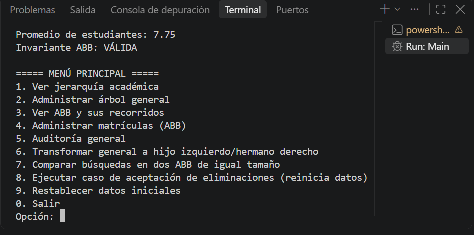
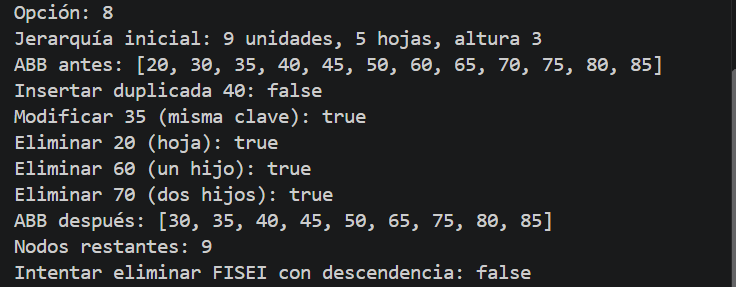
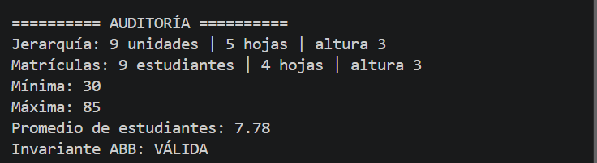
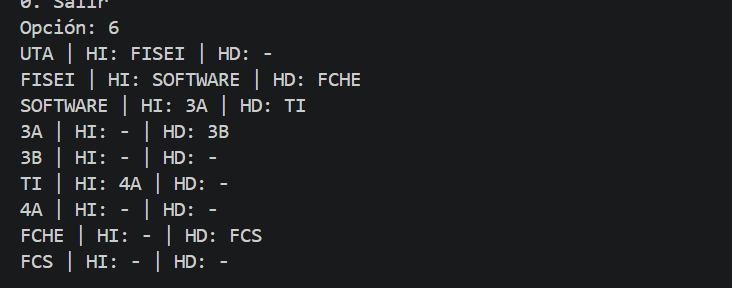
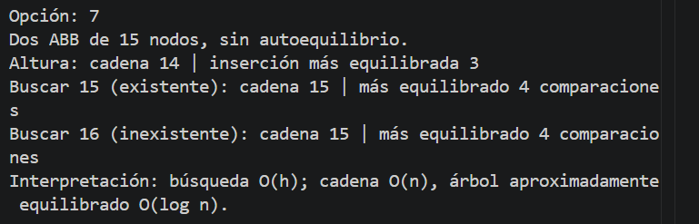
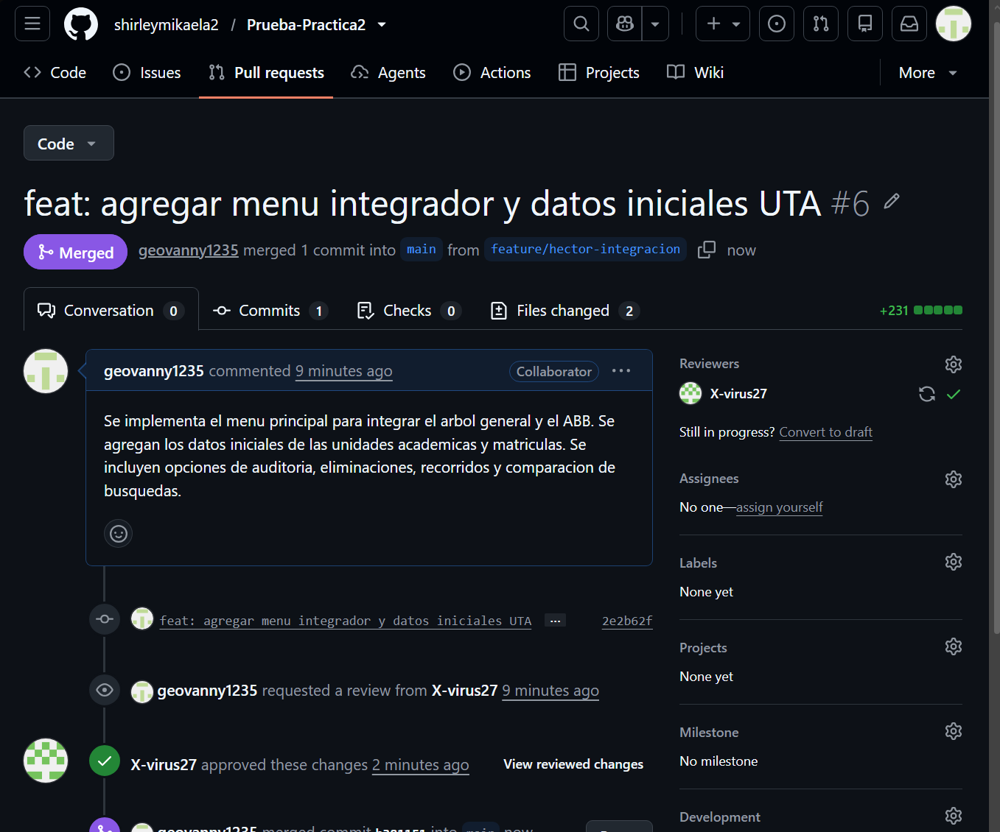

# Sistema de Auditoría Jerárquica y Académica UTA

**Universidad Técnica de Ambato — FISEI**  
**Carrera:** Ingeniería de Software  
**Asignatura:** Estructura de Datos  
**Lenguaje:** Java 17 o superior  
**Herramientas:** Visual Studio Code y GitHub

## 1. Descripción

Aplicación de consola en Java para gestionar la **jerarquía académica de la UTA** mediante un árbol general y los **registros de estudiantes** mediante un árbol binario de búsqueda (ABB). Integra ambas estructuras en un menú y genera un reporte de auditoría con información de sus nodos y operaciones.

Repositorio: https://github.com/shirleymikaela2/Prueba-Practica2

## 2. Objetivo

Implementar y comprobar operaciones recursivas de árboles, validaciones de datos, recorridos, eliminación de nodos, cálculos de métricas y análisis del costo de búsqueda.

## 3. Funcionalidades

- **Árbol general:** creación de la jerarquía, inserción, búsqueda, nivel, grado, altura, cantidad de nodos y hojas, eliminación segura y conversión hijo izquierdo/hermano derecho.
- **ABB:** inserción y búsqueda de matrículas, recorridos preorden, inorden y posorden, modificación de nombre y promedio, eliminación de nodos con cero, uno o dos hijos, mínimo, máximo y validación del orden.
- **Auditoría:** total de unidades, hojas, altura, matrícula mínima y máxima, promedio de estudiantes y validez del ABB.
- **Análisis:** comparación de búsquedas en dos ABB con igual número de nodos y diferentes alturas.
- **Pruebas:** casos de aceptación y fallos, ejecutados mediante aserciones cuando se incorpore y ejecute `Pruebas.java`.

## 4. Organización del código

Todas las clases Java se ubican en una sola carpeta **`src/`**, sin paquetes adicionales.

| Archivo | Función |
| --- | --- |
| `Main.java` | Menú principal y conexión de módulos |
| `DatosEjemplo.java` | Carga de la jerarquía y las matrículas iniciales |
| `AuditoriaAcademica.java` | Generación del reporte de auditoría |
| `NodoUnidad.java` | Representación de las unidades académicas |
| `ArbolGeneral.java` | Operaciones y métricas del árbol general |
| `NodoBinarioUnidad.java` | Representación hijo izquierdo/hermano derecho |
| `Estudiante.java` | Datos asociados a una matrícula |
| `ABB.java` | Operaciones y recorridos del ABB |
| `Pruebas.java` | Pruebas de aceptación reproducibles, si está incorporado |

## 5. Datos iniciales de la práctica

La jerarquía contiene nueve unidades: **UTA** como raíz; sus hijos **FISEI, FCHE y FCS**; dentro de FISEI están **SOFTWARE y TI**; SOFTWARE tiene **3A y 3B** y TI tiene **4A**. El resultado esperado es **9 unidades, 5 hojas y altura 3** (medida en aristas).

Las matrículas se insertan en el orden: `50, 30, 70, 20, 40, 60, 80, 35, 45, 65, 75, 85`.
Se debe rechazar la matrícula duplicada **40**, permitir modificar nombre/promedio sin cambiar la clave y comprobar las eliminaciones **20** (hoja), **60** (un hijo) y **70** (dos hijos, usando sucesor inorden).

**Inorden esperado tras eliminar:** `30, 35, 40, 45, 50, 65, 75, 80, 85`.

## 6. Ejecución

1. Instalar **JDK 17 o superior** y **Visual Studio Code** con **Extension Pack for Java**.
2. Abrir en VS Code la carpeta que contiene `src/` y `README.md`.
3. Abrir `src/Main.java` y ejecutar **Run Java**.
4. Si está integrado `src/Pruebas.java`, ejecutarlo para comprobar las pruebas automatizadas.

Alternativamente, desde la terminal, en la raíz del repositorio:

```powershell
javac -encoding UTF-8 -d out src/*.java
java -cp out Main
```

En PowerShell, si el comodín `src/*.java` no se expande correctamente, compilar desde **Run Java** en VS Code o utilizar la lista de archivos Java explícita.

## 7. Integrantes y responsabilidades

| Integrante | Rama | Responsabilidad documentada | Evidencia GitHub |
| --- | --- | --- | --- |
| Cris | `feature/cris-general` | Nodo y operaciones básicas del árbol general | Por completar |
| Andrés | `feature/andres-metricas-conversion` | Métricas de jerarquía y conversión binaria | Por completar |
| Lenin | `feature/lenin-abb-basico` | Inserción, búsqueda y recorridos ABB | Por completar |
| Josué | `feature/josue-abb-operaciones` | Modificación, eliminación y métricas ABB | Por completar |
| Héctor | `feature/hector-integracion` | Menú integrador, datos iniciales y pruebas manuales de integración | [PR #6 (aprobada y fusionada)](https://github.com/shirleymikaela2/Prueba-Practica2/pull/6) |
| Shirley | `feature/shirley-integracion` | Menú, datos iniciales, auditoría y documentación | [PR #2](https://github.com/shirleymikaela2/Prueba-Practica2/pull/2) |

Los aportes indicados deben corresponder con los commits y las revisiones efectivamente registrados en GitHub. La tabla podrá actualizarse con las PR del resto del grupo.

## 8. Preguntas para la defensa del grupo

Las siguientes capturas corresponden a **pruebas manuales realizadas en una ejecución local** del sistema. Se emplearon los datos obligatorios de la guía. No sustituyen las doce pruebas automatizadas que debe presentar el equipo.

### 8.1 Menú principal

El menú permite acceder a la jerarquía académica, el ABB, auditoría, transformación, comparación de búsquedas y casos de aceptación.



### 8.2 Eliminaciones y reglas de integridad

Se rechazó la matrícula duplicada 40; se modificó la matrícula 35 sin cambiar su clave y se eliminaron los nodos **20 (hoja), 60 (un hijo) y 70 (dos hijos)**. También se rechazó la eliminación de FISEI porque tiene descendientes.

El inorden final observado fue **[30, 35, 40, 45, 50, 65, 75, 80, 85]**, con nueve registros.



### 8.3 Auditoría posterior a las eliminaciones

La auditoría mostró **9 unidades, 5 hojas y altura general 3**. Después de las eliminaciones, el ABB tenía **9 estudiantes**, matrícula mínima **30**, máxima **85**, promedio **7.78** e invariante **VÁLIDA**.



### 8.4 Transformación hijo izquierdo / hermano derecho

Se verificaron, entre otras, las relaciones **UTA → FISEI** (primer hijo), **FISEI → FCHE** y **FCHE → FCS** (hermanos derechos).



### 8.5 Comparación de búsquedas

Se construyeron dos ABB de 15 nodos, sin autoequilibrio: uno con inserciones ascendentes (altura 14) y otro con inserciones distribuidas (altura 3). Para los identificadores 15 y 16 se observaron **15 comparaciones** en el primero y **4** en el segundo.



### 8.6 Evidencia de colaboración en GitHub

El aporte de Héctor se registró en la [PR #6](https://github.com/shirleymikaela2/Prueba-Practica2/pull/6), revisada por otro integrante y posteriormente fusionada con `main`.



### Pendientes de verificación por el grupo

- [ ] Registrar la ejecución real de **al menos 12 pruebas automatizadas** con sus resultados.
- [ ] Completar enlaces a commits y pull requests de los demás integrantes.
- [ ] Anotar el hash del commit final de entrega.
=======
### 1. ¿Por qué no es correcto modificar la matrícula de un nodo sin reposicionarlo en un ABB?

**Respuesta:** Porque la matrícula es la clave que determina la posición del nodo dentro del Árbol Binario de Búsqueda (ABB). Si se modifica directamente, puede romperse la propiedad de ordenamiento. Lo correcto es eliminar el nodo y volver a insertarlo con la nueva matrícula.

### 2. Trace la eliminación de un nodo con dos hijos y explique por qué el sucesor inorden mantiene el orden del ABB.

**Respuesta:** Para eliminar un nodo con dos hijos, se busca su sucesor inorden, que es el menor valor del subárbol derecho. Por ejemplo, al eliminar el nodo 70, su sucesor es 75. Se reemplaza el valor 70 por 75 y después se elimina el nodo 75 de su posición original. Así se conserva el orden del ABB.

### 3. Si ambos árboles tienen n nodos, ¿por qué la búsqueda en uno puede ser O(n) y en otro O(log n)?

**Respuesta:** Porque el tiempo de búsqueda depende de la altura del árbol. En un árbol degenerado, los nodos forman una cadena y la búsqueda puede ser O(n). En uno equilibrado, la altura es aproximadamente logarítmica, por lo que la búsqueda puede ser O(log n). Un ABB normal no se equilibra automáticamente.

### 4. En hijo-izquierdo/hermano-derecho, ¿qué conserva la equivalencia estructural y qué interpretación errónea debe evitarse?

**Respuesta:** Esta representación conserva la jerarquía del árbol general: el enlace izquierdo apunta al primer hijo y el derecho al siguiente hermano. Debe evitarse interpretar al hermano derecho como si fuera un hijo derecho real, porque eso cambiaría el significado de la estructura original.

### 5. ¿Cómo evidencia GitHub que cada integrante implementó y probó una parte real del proyecto?

**Respuesta:** GitHub permite verificar los aportes mediante ramas individuales, commits con cambios identificables y pull requests revisadas por otros integrantes. Además, las pruebas ejecutadas, capturas y documentación permiten demostrar que cada integrante desarrolló y comprobó su parte del proyecto.

## 9. Consideraciones

No se utilizan `TreeMap`, `TreeSet` ni librerías que implementen los árboles automáticamente. El ABB ordinario **no garantiza autoequilibrio**: su costo de búsqueda depende de la altura `h` y es `O(h)`. En el peor caso puede ser `O(n)`; en un árbol de altura logarítmica, `O(log n)`.

**Nota organizativa:** el documento de evaluación menciona equipos de 3 a 5 estudiantes; debe confirmarse con el docente la participación de seis integrantes.
